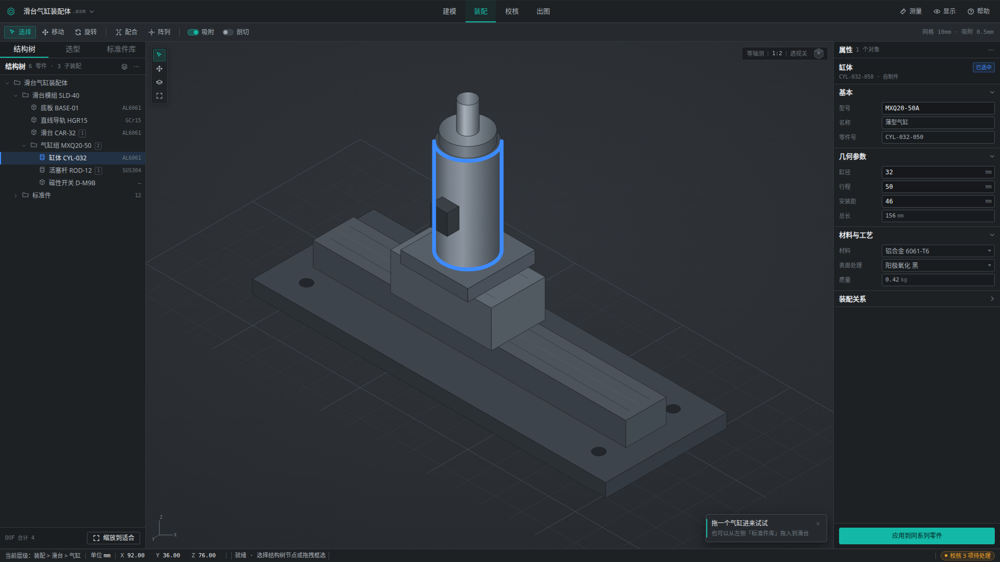
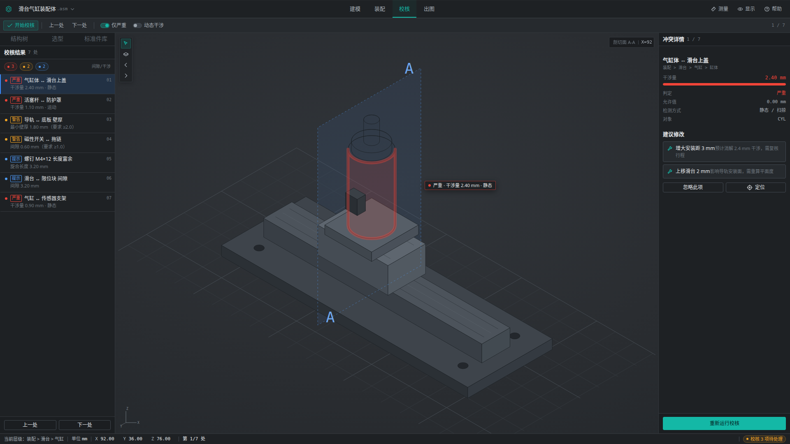
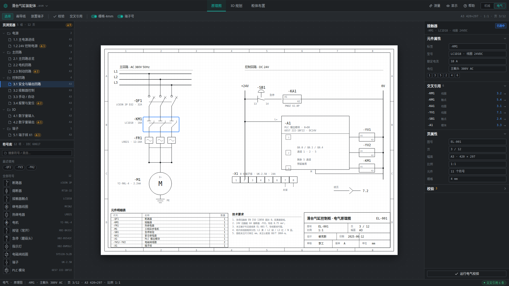
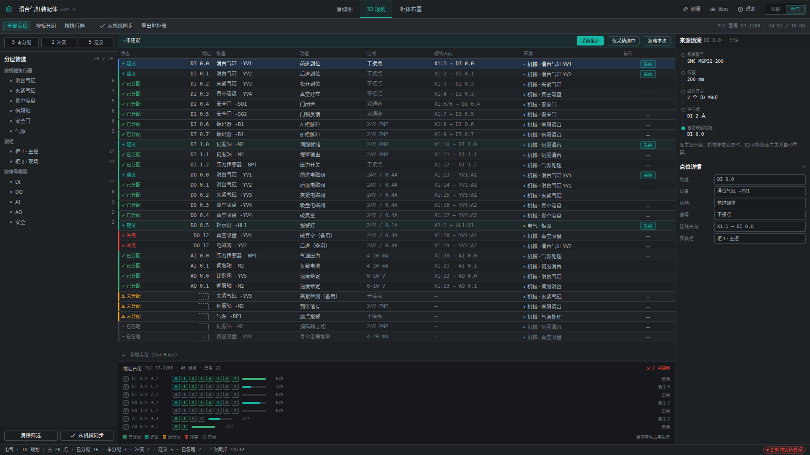

# 自动化设备设计软件 · UI 原型

非标自动化整机设计软件的桌面客户端高保真原型。覆盖**机构选型 → 标准件调用 → 装配约束 → 干涉校核 → 出图 → BOM** 完整链路，并在其上扩展**电气设计域**（原理图 / IO 规划 / 柜体布置）。

纯原生 HTML/CSS/JS，零依赖、零构建，双击 `index.html` 即可运行。



## 快速开始

```bash
# 方式一：直接打开
open index.html        # macOS
start index.html       # Windows
xdg-open index.html    # Linux

# 方式二：本地服务器（推荐，避免个别浏览器的 file:// 限制）
python3 -m http.server 8099
# 访问 http://localhost:8099
```

建议用 1920×1080 视口查看。1440 宽下侧栏会等比收窄，无横向滚动。

## 设计决策

### 视觉：不打搅判断的精密仪器

界面定位是「像卡尺、像夹具」——克制、无装饰、数据即视觉主体。参考 Fusion 360 的深色分层与 EPLAN 的工程信息密度，舍弃 SolidWorks 的彩色 Ribbon（6 小时以上连续使用视觉噪声过高）与 Onshape 的大留白（1320px 画布装不下密集面板）。

**颜色双轨制**是整套视觉的核心约束：

| 颜色 | 值 | 语义 | 禁止用途 |
|------|-----|------|---------|
| 青绿 | `#14B8A6` | 可操作：按钮、激活工具、聚焦描边 | 不得表示选中 |
| 蓝 | `#3D8BFD` | 已选中：树节点、几何体、表格行 | 不得表示可点击 |

画布三域分立，互不混用描边体系：

- **3D 视口** `#2A2D31` —— 中性灰，彩色零件（阳极氧化件、铜色、警示黄）色相还原优于白底
- **2D 工程图** 固定白纸，不随主题变化
- **面板** `#1E2124` —— 常驻区域压暗，视觉注意力分配给画布

### 布局：8pt 网格

| 区域 | 尺寸 |
|------|------|
| 主工具条 | 44px |
| 上下文工具条 | 36px |
| 左侧栏（结构树 / 选型 / 标准件库） | 280px |
| 右侧属性面板 | 320px |
| 状态栏 | 26px |
| 控件高（紧凑 / 标准 / 强调） | 24 / 28 / 32px |
| 表格行高 · 树节点行高 | 24px · 24px（缩进 16px/级） |

1920 宽下画布净宽 1320px。圆角上限 3px（弹层 4px、对话框 6px）；阴影只用于弹层与对话框，其余层级靠 1px 描边 + 顶部内高光表达。

### 交互：默认即时生效

属性面板编辑走 150ms 防抖即时生效，不设「应用」按钮——高频微调不能多一次点击。仅三类不可逆变更保留 Apply/Cancel：更换配合类型、删除特征、替换标准件型号。

三个已知卡点全部用**内联提示**接管，不用弹窗：

| 卡点 | 处理 |
|------|------|
| 选型参数不知填什么 | 上下文工具条实时估算「推力 82N / 寿命 4200km / 推荐 φ32」 |
| 约束后仍有多余自由度 | 树节点常显 `DOF 2` 角标，工具条列出候选约束 |
| 干涉结果取舍困难 | 分级列表 + 3D 自动剖切定位 + 「忽略并记录」留痕 |

选择模型沿用 CAD 惯例：左→右框选仅完全包含，右→左框选相交即中；`Alt+单击` 穿透下钻，双击进入零件内部。

## 功能视图

| 视图 | 内容 |
|------|------|
| 装配工作台 | 结构树 ↔ 3D 联动、属性即时编辑、框选、DOF 角标 |
| 选型计算 | 8 项工况参数重算、缸径系列对比、推荐型号回写装配 |
| 标准件库 | 品牌/品类筛选、7 列排序、规格预览 |
| 干涉校核 | 7 处冲突分级、上下步进、剖切面 A-A 定位 |
| 出图与 BOM | A2 图框 + 剖面线 + 尺寸标注（SVG）、7 项明细表 |



### 电气设计域（扩展）

顶栏右端「机械 | 电气」两段式切换器（`Ctrl+Alt+1` / `Ctrl+Alt+2`）。切换时模式组整体替换（机械 4 个 ↔ 电气 3 个），左右栏与状态栏同步换内容，项目树保留展开态、无过渡动画。电气域为**加而不改**的扩展：`app.js` 零改动，新增 `electrical.js` / `electrical.css`。

| 视图 | 内容 |
|------|------|
| 电气原理图 | A3 横向白纸（420:297）· 图框分区 + 标题栏 + 4mm 栅格 · 主回路（L1/L2/L3→QF1/KM1/FR1→M1）· 控制回路（24V/0V→SB1→KA1→A1→YV1/YV2/KM1）· 12 项符号库拖放 + 自动编号 + 交叉引用 + 校验 |
| IO 规划 | 28 点位表（建议/未分配/冲突三重编码）· 分层筛选 · 批量采纳建议 · 46 通道地址占用图 · 机械派生链追溯 |
| 柜体布置 | 柜门正视图 + 侧视图（mm 标尺）· 导轨吸附放置/拖动 · 300ms 防抖重算温升/载流/空间余量 · 超限斜纹 |





图纸与柜体遵循「白纸世界」：浅底 + `#1A1D20` 墨线，线宽 1px 且 `vector-effect:non-scaling-stroke`，与面板的深色描边体系严格分离。

电气域的核心不是画图，而是**把机械侧的转换关系显式化**：机械侧每个气缸/电机/传感器都决定了电气侧的点位与回路。IO 规划页因此提供「来源追溯」——选中任一点位，右栏展示从 `SMC MGP32-200 → 行程 200mm → 磁性开关 2 个 → DI 2 点 → 地址 DI 0.0` 的完整派生链。机械侧改动以**建议**形态进入电气侧（行首青绿徽标 + 批量采纳条），电气侧的改动只回写提示、不反向修改机械模型，避免两侧循环触发。

## 快捷键

| 分组 | 键位 |
|------|------|
| 全局 | `Ctrl+K` 命令面板 · `Esc` 取消 · `Delete` 删除 · `F2` 重命名 · `F1` 帮助 |
| 视图 | `F` 缩放到适合 · `滚轮` 缩放 · `中键拖` 平移 · `S` 视图立方 · `Ctrl+0` 等轴测 |
| 设计域 | `Ctrl+Alt+1` 机械域 · `Ctrl+Alt+2` 电气域 |
| 建模 | `Q` 配合约束 · `T` 插入标准件 · `M` 测量 · `Ctrl+拖拽` 阵列复制 |
| 文件 | `Ctrl+N` 新建 · `Ctrl+S` 保存 · `Ctrl+E` 导出 |

避开 `Win+*`、`Alt+Tab`、`Ctrl+Alt+Del`；几何复制不占用 `Ctrl+C/V`（留给文本），改用 `Ctrl+拖拽`。

## 文件结构

```
.
├── index.html              外壳：顶栏 / 上下文条 / 5 视图 / 状态栏 / 命令面板
├── styles.css              设计 token 与组件样式
├── app.js                  等轴测投影、面板渲染、交互逻辑、计算与图纸生成
├── electrical.css          电气域样式（复用 styles.css token，不新增 UI 色）
├── electrical.js           电气域三个视图：原理图 / IO 规划 / 柜体布置
└── docs/screenshots/       各视图截图
```

`app.js` 中的 3D 视口由 `(x−y)·cos30 / (x+y)·0.5−z` 实时投影生成，选中/命中/悬停态全部走 CSS `data-*` 属性切换，不重建 DOM。

## 已知限制

这是 UI 原型，不是可用的 CAD 工具：

- 无几何内核：3D 为固定等轴测示意图，不能旋转/缩放/测点；框选命中按 SVG 包围盒近似
- 无真实装配：拖入零件不发生求解，属性改动只重算缸体尺寸，不改拓扑
- 无撤销栈：仅状态栏单步回滚
- 导出为前端提示，未落地文件；图纸为静态 SVG，不支持标注编辑
- 无持久化：刷新即重置
- 电气域：原理图为静态 SVG 生成的「可交互图纸」，符号可放置/选中/交叉引用定位，但不做导线自动布线；柜体温升与载流量为简化热模型（功耗/容积 + 风扇折算），非 CFD

## 下一步

优先打通**「拖气缸进视口 → 自动生成配合约束」**这一段动线——这是产品核心循环，比补齐更多页面更有价值。
