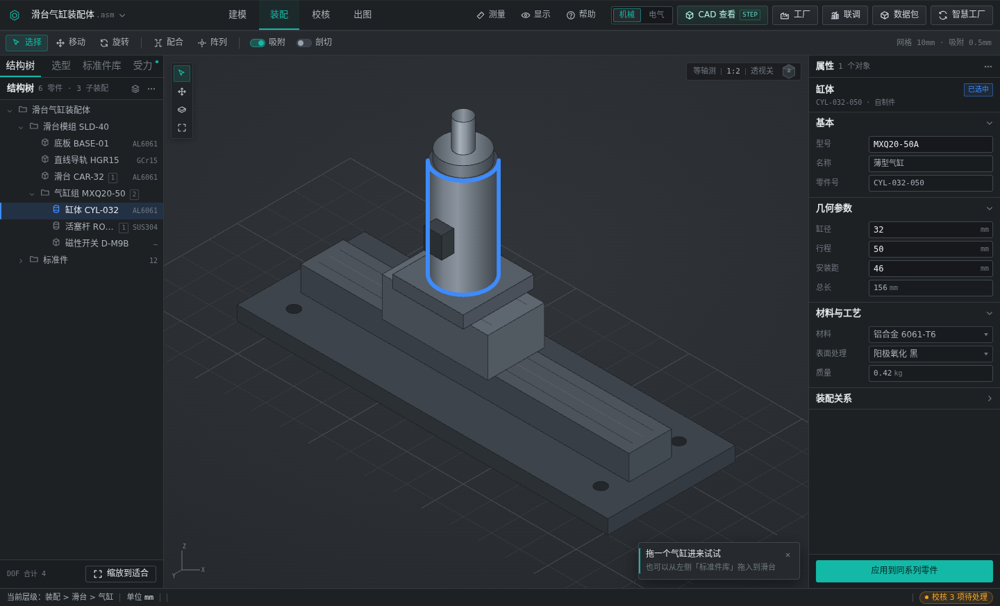
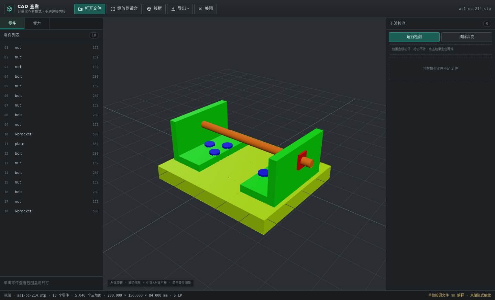
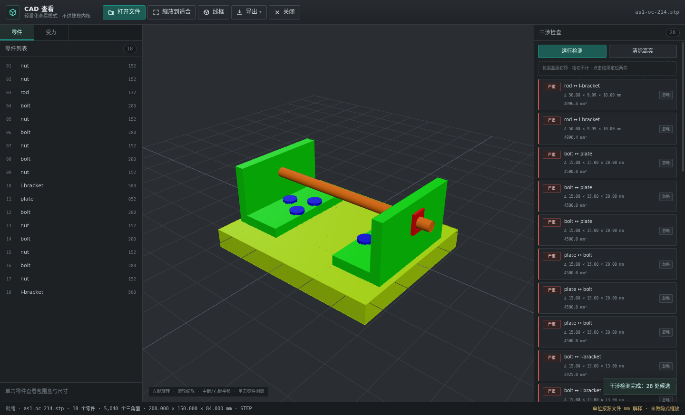
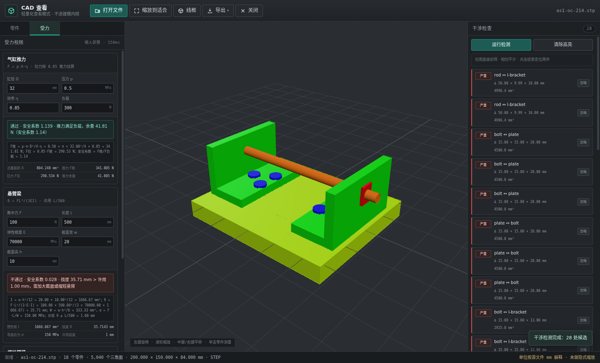
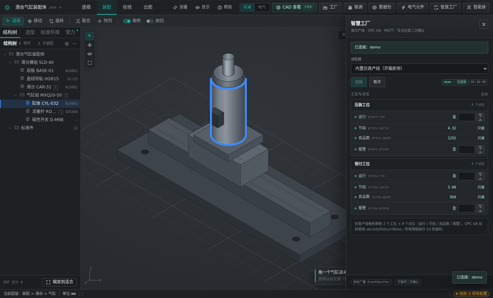
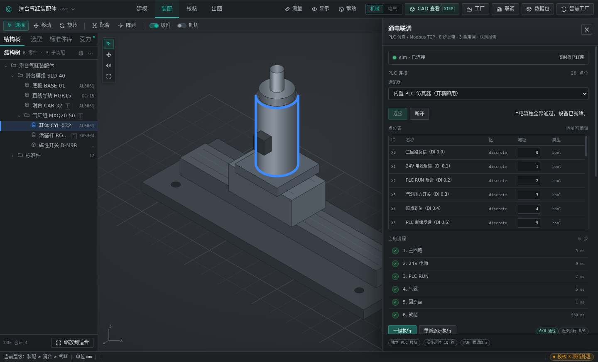
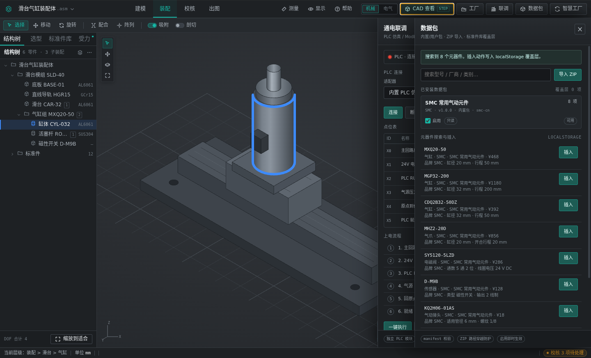
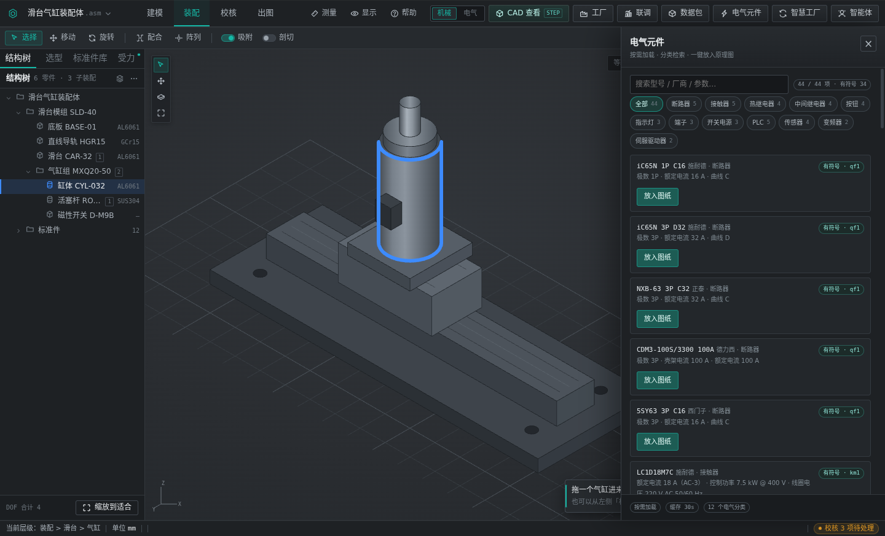
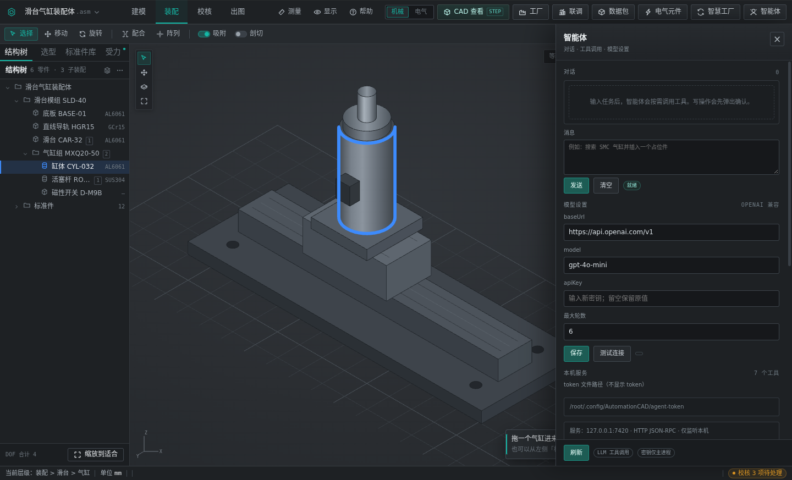
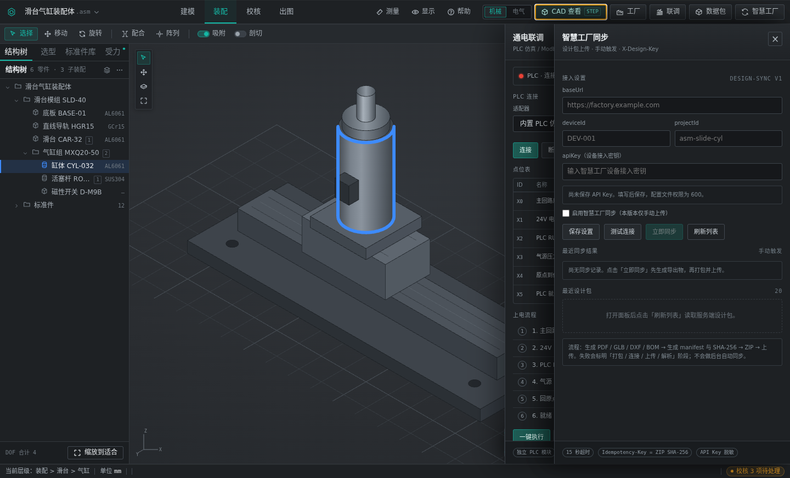

# AutomationCAD · 非标自动化整机设计软件（Windows 11 桌面版）

面向非标自动化整机的**机械 + 电气协同设计工作台**：机械域覆盖机构选型 → 标准件调用 → 装配 → 干涉校核 → 出图 → BOM，电气域覆盖原理图 → IO 规划 → 柜体布置。桌面版在此基础上叠加 **CAD 轻量化查看、电气元件库、PLC 通电联调、智慧工厂对接、智能体（JSON-RPC / MCP / 应用内对话）**，单机离线可用。

- 当前版本：**v0.2.0**（Windows NSIS 安装包已发布）
- 运行环境：Windows 11 x64；Electron 45 + TypeScript + Vite
- 技术底座：渲染层直接复用仓库根目录的网页原型，桌面能力全部通过**注入扩展**叠加，原型文件（`index.html` / `app.js` / `styles.css` / `electrical.*`）**零改动**
- 质量基线：**146 个单元测试全绿**，另有覆盖 CAD / 机核 / 导出 / PLC / 联调 / 同步 / 电气库 / 智能体 / 工厂的 headless smoke



*主界面：左侧仍是原型的结构树 / 选型 / 标准件库 / 受力视图，顶栏右侧新增桌面入口——CAD 查看（STEP）、工厂、联调、数据包、电气元件、智慧工厂、智能体。桌面能力挂在原型之上，不改动原有布局与交互。*

## 界面一览

以下截图均来自 Electron 实跑 + CDP 抓取（1440×873），不是设计稿。

| 截图 | 说明 |
|------|------|
| `01-home.png` | 主界面 |
| `02-cad-assembly.png` | CAD 查看 · STEP 装配体 |
| `03-interference.png` | 干涉检测 |
| `04-stress.png` | 受力分析 |
| `05-factory.png` | 联调前的点位表校验（异常路径） |
| `06-commission.png` | 通电联调 · 6 步全通过 |
| `07-packs.png` | 数据包管理 |
| `08-elec-library.png` | 电气元件库 |
| `09-agent.png` | 智能体面板 |
| `10-sync-settings.png` | 智慧工厂同步设置 |

### CAD 查看：真实 STEP 装配体



*CAD 查看：载入真实 STEP 装配体（18 个零件、5,040 个三角面），左侧零件列表可点选定位，中间 three.js 视口支持旋转 / 缩放 / 平移，底部给出解析统计。*

### 干涉检测：28 处命中按严重度分组



*干涉检测：AABB 初筛一次跑出 28 处候选，按严重度分组并给出重叠尺寸与体积；点击结果可在 3D 视口定位到两个零件，「忽略」会把该零件对写入白名单。*

### 受力分析：公式与安全系数可见



*受力分析：气缸推力按 `F = p·πD²/4·η` 计算，同时给出拉力（0.85 系数）、余量与安全系数；悬臂梁与螺栓预紧同页，超限项直接标红并给出改法建议。*

### 通电联调：先校验点位表，再上电



*联调异常路径：点位表为空时连接直接报「PLC 点位表不能为空」，不允许带着空表跑上电流程——这是实跑截图，不是示意。*



*通电联调：内置 PLC 仿真器连接成功，28 点位表就绪，6 步上电（主回路 → 24V → PLC RUN → 气源 → 回原点 → 就绪）全部通过并记录每步耗时，结果可导出 A3 PDF 联调章节。*

### 数据包：内置包、导入与启停



*数据包：内置包只读展示（SMC 常用气动元件 8 个型号），支持 ZIP 导入、启停与型号 / 厂商 / 类别检索；启停即时影响标准件搜索结果，「插入」写入渲染层覆盖层而不修改原型代码。*

### 电气元件库：44 型号 / 12 分类



*电气元件库：iec-cn 数据包按需加载，12 个分类共 44 个型号，其中 34 个带原理图符号；卡片标注符号位号，点「放入图纸」即把符号插入原理图。*

### 智能体：对话 / 工具 / 模型设置



*智能体面板：自上而下是对话与工具调用区、模型设置（OpenAI 兼容 baseUrl / model / apiKey，密钥只回显掩码）、本机服务信息（127.0.0.1:7420、7 个工具、token 文件路径）。写操作执行前会弹出二次确认。*

### 智慧工厂同步设置



*智慧工厂同步设置：baseUrl、机台编号、项目、API Key（保存后只回显掩码，配置文件权限 600）与启用开关；「测试连接 / 立即同步」均手动触发，没有后台自动同步。*

## 功能矩阵

### 机械域（原型 5 视图 + 桌面校核）

| 能力 | 内容 | 状态 |
|------|------|------|
| 装配工作台 | 结构树 ↔ 3D 联动、属性即时编辑、框选、DOF 角标 | ✅ 原型 |
| 选型计算 | 8 项工况参数重算、缸径系列对比、推荐型号回写装配 | ✅ 原型 |
| 标准件库 | 品牌 / 品类筛选、7 列排序、规格预览 | ✅ 原型 |
| 干涉校核 | AABB 初筛：重叠量 / 体积 / 定位 / 严重度分级 / 忽略白名单 | ✅ 桌面 |
| 受力校核 | 气缸推力、悬臂梁、螺栓预紧，带公式与安全系数 | ✅ 桌面 |
| 出图与 BOM | A3 PDF 报告、DXF、GLB、OBJ、BOM（CSV / XLSX） | ✅ 桌面 |

### 电气域（原型 3 视图 + 数据包）

| 能力 | 内容 | 状态 |
|------|------|------|
| 电气原理图 | A3 横向白纸、图框与标题栏、主回路 / 控制回路、符号拖放与交叉引用 | ✅ 原型 |
| IO 规划 | 28 点位表、建议 / 未分配 / 冲突编码、机械派生链追溯 | ✅ 原型 |
| 柜体布置 | 柜门与侧视图、导轨吸附、温升 / 载流 / 空间余量重算 | ✅ 原型 |
| 电气元件库 | iec-cn 数据包：44 型号 / 12 分类 / 34 个带符号，按需加载，「放入图纸」插入原理图 | ✅ 桌面 |

### CAD 与数据

| 能力 | 内容 | 状态 |
|------|------|------|
| CAD 查看 | occt-import-js（STEP / IGES / BREP）+ three.js（STL / OBJ / GLTF / GLB） | ✅ |
| 大装配实测 | 424 KB 装配体 → 5,040 三角面，解析 559 ms | ✅ |
| 无 WebGL 降级 | 渲染不可用时退化为解析统计面板，不白屏 | ✅ |
| 数据包 | 内置包 + 用户 ZIP 导入、manifest 校验、路径穿越防护、启停、检索 | ✅ |

### PLC / 联调 / 工厂

| 能力 | 内容 | 状态 |
|------|------|------|
| PLC 适配器 | 仿真器（表达式 / 自锁 / 定时器）+ Modbus TCP（FC01–06） | ✅ |
| 点位模型 | 28 个点位，读写在主进程统一超时 | ✅ |
| 通电联调 | 6 步上电 + 3 条用例，逐步 / 一键执行，导出 PDF 章节 | ✅ 仿真验证 |
| 智慧工厂 | demo（2 工位 / 8 点位）、OPC UA、MQTT 三适配器 + 实时值面板 | ✅ demo 实测 |
| 设计包同步 | manifest / 指纹幂等、`X-Design-Key`、手动上传、失败阶段可区分 | ✅ 客户端 |

### 智能体

| 能力 | 内容 | 状态 |
|------|------|------|
| 工具集 | `list_components` / `search_components` / `import_cad` / `get_bom` / `run_interference_check` / `insert_component` / `undo_last`（7 个） | ✅ |
| JSON-RPC | `127.0.0.1:7420`，Bearer token（userData 下 `agent-token`），仅监听本机 | ✅ |
| MCP stdio | 复用同一工具注册表；写工具经桌面 RPC 代理，桌面未启动时明确返回 `DESKTOP_NOT_RUNNING` | ✅ |
| 应用内对话 | OpenAI 兼容接口、工具调用循环、写操作二次确认、密钥仅本机进程 | ✅ |

## 快速开始

### 方式一：网页原型（零依赖，双击即开）

仓库根的 `index.html` 就是完整原型，不需要 Node、不需要构建：

```bash
# Windows
start index.html
# macOS
open index.html
# Linux
xdg-open index.html
```

如遇浏览器对 `file://` 的限制，可起一个静态服务器：`python3 -m http.server 8099`，访问 `http://localhost:8099`。建议 1920×1080 视口。

### 方式二：桌面版（Windows 11）

**安装包**：从 [Releases · v0.2.0](https://github.com/owlco001/automation-cad-prototype/releases/tag/v0.2.0) 下载 `AutomationCAD-Setup-0.2.0.exe`（约 133 MB），双击安装。未做代码签名，SmartScreen 会拦一次，选「更多信息 → 仍要运行」。

**从源码运行**（需 Node 22+）：

```powershell
git clone https://github.com/owlco001/automation-cad-prototype.git
cd automation-cad-prototype\desktop
npm ci
npm run build:ext   # 首次必需：dist/ 与 dist-electron/ 不入库
npm start
```

构建过一次之后，日常只需 `cd desktop` + `npm start`。Linux 开发机可用 `npm run smoke`（xvfb + `--headless-smoke`）验证主流程。

### 方式三：把桌面能力接给外部 Agent

桌面启动后即开放 JSON-RPC；MCP（stdio）入口在 `desktop/dist-electron/mcp.cjs`。Claude Code / Codex 的配置样例、token 位置、curl 示例见 [desktop/README.md](desktop/README.md)。

## 目录结构

```
.
├── index.html / app.js / styles.css          # 网页原型：外壳、交互与计算、设计 token
├── electrical.js / electrical.css            # 电气域三视图（原型扩展）
├── desktop/                                  # Electron 桌面版
│   ├── electron/                             # 主进程、preload、IPC 路由
│   ├── src/
│   │   ├── extension.ts                      # 渲染层注入入口（原型零改动）
│   │   ├── cad/                              # STEP/IGES/BREP 解析、three.js 查看器、WebGL 降级
│   │   ├── mech/                             # 干涉初筛 + 气缸/悬臂梁/螺栓校核
│   │   ├── export/                           # PDF / DXF / GLB / OBJ / BOM
│   │   ├── packs/                            # 数据包注册表、数据包面板、电气元件库面板
│   │   ├── plc/                              # 仿真器 + Modbus TCP
│   │   ├── commission/                       # 6 步上电、用例、联调报告
│   │   ├── factory/                          # demo / OPC UA / MQTT 适配器与面板
│   │   ├── sync/                             # 智慧工厂设计包同步客户端
│   │   ├── agent/                            # JSON-RPC、MCP、MCP 写工具代理、应用内对话
│   │   ├── ui/                               # 注入方式与面板壳
│   │   └── shared/                           # 共享类型
│   ├── test/                                 # node:test 单测与集成测试（146 个）
│   ├── build/                                # 应用图标
│   ├── scripts/                              # esbuild 打包 main / preload / MCP
│   └── release/                              # 本地产物（不入库）
├── packs/builtin/                            # smc-cn（8 型号）、iec-cn（44 型号 / 12 分类）
├── docs/
│   ├── desktop/                              # 需求、架构、状态、模块索引、工厂对接说明
│   ├── desktop/screenshots/                  # 桌面版真实截图（10 张）
│   ├── reference/                            # 电气元件参考表
│   └── screenshots/                          # 网页原型截图
├── tasks/                                    # 开发任务拆解
└── .github/workflows/windows.yml             # windows-latest 构建 NSIS（手动触发）
```

## 架构要点

- **加而不改**：渲染层就是原型页面，`desktop/src/extension.ts` 在其上挂载 CAD 视图与各面板。原型仍可单独双击运行，桌面版升级不会分叉出第二套 UI。
- **进程边界**：`contextIsolation: true`、`nodeIntegration: false`、`sandbox: true`；渲染层只有 `window.desktop.*`，没有 fs / net 权限。文件、数据包、协议连接、Agent server 全在主进程。
- **重活不堵 UI**：occt WASM 解析在 Web Worker 中执行；three.js 渲染在渲染层。
- **同一份工具注册表**：UI 按钮、JSON-RPC、MCP 共用 `src/agent/tools.ts`，能力不会三处漂移。
- **失败要说清楚**：WebGL 不可用退化为统计面板；桌面未启动时 MCP 返回 `DESKTOP_NOT_RUNNING`；工厂 / PLC 连接失败返回中文 `{ ok:false, code, message }`，不抛未捕获异常。

## 测试与构建

```bash
cd desktop
npm test          # 146 个单测（node:test）
npm run smoke     # xvfb + Electron headless，强制走无 WebGL 路径
npm run build:ext # tsc --noEmit + Vite 扩展 + esbuild main/preload/MCP
```

smoke 覆盖并断言：

- CAD 解析统计（`cube.stp` → 1 零件 / 12 三角面）与无 WebGL 降级面板；
- 干涉、受力、导出的计算与文件写出；
- PLC 28 点位、6 步上电、3 条用例；
- 智慧工厂 demo 连接（2 工位 / 8 点位）与设计包同步（manifest / ZIP / 幂等）；
- 电气元件库加载与「放入图纸」；
- 智能体 7 工具注册、渲染桥读写、对话面板字段。

输出形如 `SMOKE_UI_OK`、`SMOKE_PLC_OK points=28`、`SMOKE_COMMISSION_OK`、`SMOKE_AGENT_TOOLS_OK tools=7`，最后 `SMOKE_OK`。

**CI**：`.github/workflows/windows.yml` 在 `windows-latest` 上跑 `npm ci → build:ext → test → electron-builder --win nsis --x64`，产物为 `AutomationCAD-Setup-*.exe` + blockmap。当前**仅手动触发**：`gh workflow run windows-build --ref main`；推 `v*` tag 时额外发布到 GitHub Release。本地只想出免安装包可用 `npx electron-builder --win zip --x64`。

## 已知限制

- **安装包未签名**：无代码签名证书，Win11 SmartScreen 首次会提示。
- **OPC UA 只支持 SecurityPolicy=None**，未接真实 PLC；MQTT 未连真实 broker；Modbus 未连真机（仿真器已实测）。
- **智慧工厂服务端未落地**：客户端 `/api/v1/design-sync/*` 调用已实现，服务端接口待补，集成测试只连本地 mock；服务端改动清单见 [SMART-FACTORY-INTEGRATION.md](docs/desktop/SMART-FACTORY-INTEGRATION.md)。
- **便携包偏大**（Electron 45 + node-opcua，解压后数百 MB），后续可按需懒加载 node-opcua 或改 sidecar。
- **干涉为 AABB 初筛**，不是精确布尔求交；贴合面、螺纹啮合可能被误报，需要白名单收口。
- **智能体对话的真实模型兼容性**只按 OpenAI 兼容协议验证，测试连接与工具调用使用本地假服务；各服务商差异需逐一验证。
- **原型侧的固有限制仍在**：3D 视口为固定等轴测示意投影，不支持真实几何求解；属性编辑只重算尺寸不改拓扑；无多步撤销栈。桌面版的 CAD 查看是独立视图，不替代原型建模。

## 文档索引

| 文档 | 内容 |
|------|------|
| [docs/desktop/STATUS.md](docs/desktop/STATUS.md) | 当前进度、验证记录、未完成项与风险 |
| [docs/desktop/MODULES.md](docs/desktop/MODULES.md) | 模块索引、跨模块数据流、维护约定 |
| [docs/desktop/ARCHITECTURE.md](docs/desktop/ARCHITECTURE.md) | 技术选型、进程与安全边界、关键接口 |
| [docs/desktop/REQUIREMENTS.md](docs/desktop/REQUIREMENTS.md) | 需求来源与验收口径 |
| [docs/desktop/PROTOTYPE.md](docs/desktop/PROTOTYPE.md) | 网页原型：8 视图、设计 token、交互约定 |
| [docs/desktop/PLUGIN-PACKS.md](docs/desktop/PLUGIN-PACKS.md) | 数据包格式与加载规则 |
| [docs/desktop/SMART-FACTORY-INTEGRATION.md](docs/desktop/SMART-FACTORY-INTEGRATION.md) | 智慧工厂服务端待实现的接口清单 |
| [docs/desktop/CI.md](docs/desktop/CI.md) | Windows 安装包构建与手动触发方式 |
| [docs/reference/electrical-components.md](docs/reference/electrical-components.md) | 电气元件参数参考 |
| [desktop/README.md](desktop/README.md) | 桌面版命令、MCP 接入、JSON-RPC 与各面板细节 |

> `packs/builtin` 中的元器件参数仅用于选型演示，定型前请以厂商最新样本 / 铭牌为准。
