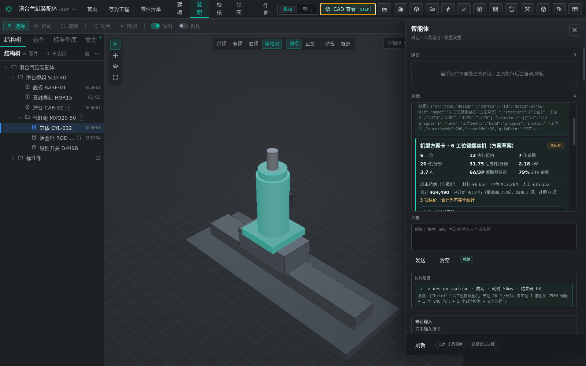
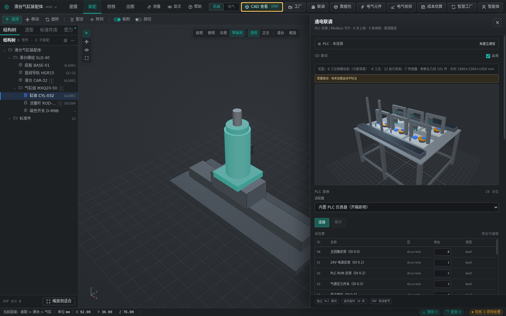
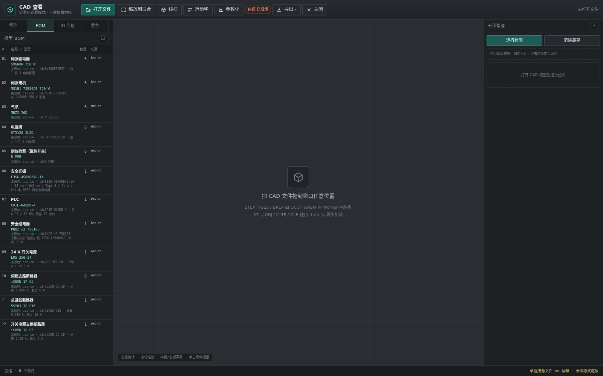
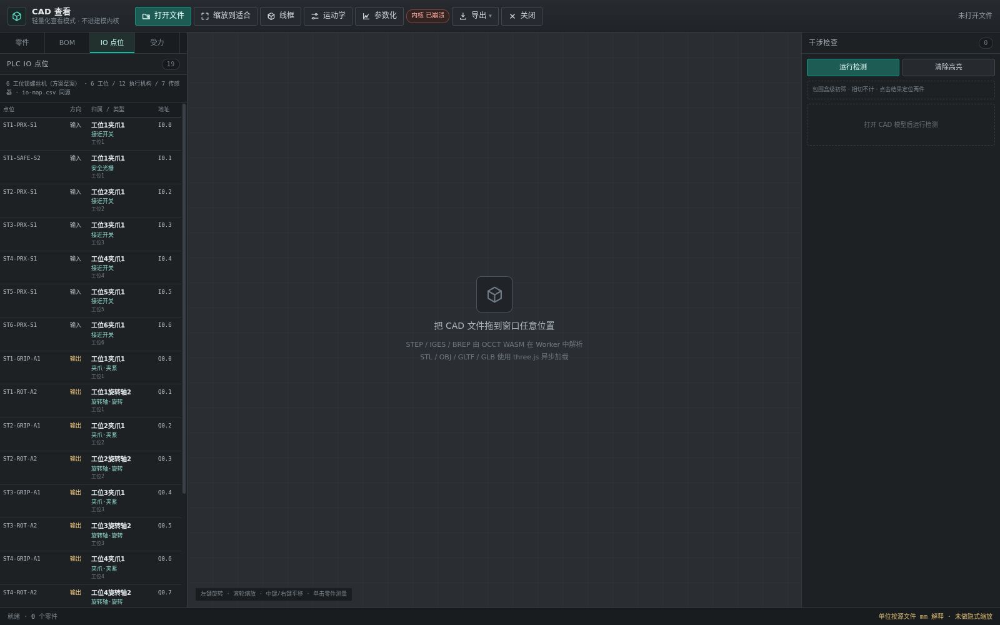

# 六工位锁螺丝机 · 完整设计案例

本文是一个从中文需求到 3D / BOM / PLC IO 的完整案例。案例数字不是手写的：`desktop/scripts/build-machine-case.mjs` 调用 `parseMachineBrief`、`synthMachine`、`mapMachineBom` 与 `buildMachineIoMap` 生成 [`eval/machine-case.json`](eval/machine-case.json)，再由该 JSON 生成方案表和截图校验结果。

```bash
cd desktop
node scripts/build-machine-case.mjs       # 重算案例 JSON
npm run screenshots:machine               # 真实 Electron 截图，并重新生成案例 JSON
```

## 需求原文

```text
六工位锁螺丝机，节拍 20 件/分钟，每工位 1 套汇川 750W 伺服 + 1 个 SMC 气爪 + 1 个到位检测 + 安全光栅
```

## 解析结果

| 项目 | 解析值 | 说明 |
|------|--------|------|
| 工艺 | `screw`（锁螺丝） | 由「锁螺丝机」识别 |
| 工位数 | 6 | 由「六工位」识别 |
| 目标节拍 | 20 件/分钟 → 3.00 秒/件 | `60 / 20` |
| 执行机构 | 6 个 `gripper` + 6 个 `rotary`，共 12 个 | 750 W 伺服按旋转轴建模，气爪单独建模 |
| 传感器 | 6 个 `proximity` + 1 个 `safety`，共 7 个 | 到位检测归一为接近开关；安全光栅按整机 1 套记录 |
| 品牌 | 汇川 | 记录品牌，具体伺服型号由 BOM 映射确认 |
| 供电 | 未指定 | 电气估算按 380 V 三相 / 220 V 支路假设计算 |

解析器同时给出说明：伺服/步进执行机构 6 台（750W），按旋转轴建模。当前方案共生成 19 个唯一点位：12 个执行机构点位 + 7 个传感器点位。

## 方案表

### 工位、机构与点位

| 工位 | 执行机构（点位） | 检测 / 安全（点位） |
|------|------------------|----------------------|
| 工位1 | 夹爪 `st1-gripper-1` · `ST1-GRIP-A1`；旋转轴 `st1-rotary-2` · `ST1-ROT-A2` | 接近开关 `ST1-PRX-S1`；安全光栅 `ST1-SAFE-S2` |
| 工位2 | 夹爪 `st2-gripper-1` · `ST2-GRIP-A1`；旋转轴 `st2-rotary-2` · `ST2-ROT-A2` | 接近开关 `ST2-PRX-S1` |
| 工位3 | 夹爪 `st3-gripper-1` · `ST3-GRIP-A1`；旋转轴 `st3-rotary-2` · `ST3-ROT-A2` | 接近开关 `ST3-PRX-S1` |
| 工位4 | 夹爪 `st4-gripper-1` · `ST4-GRIP-A1`；旋转轴 `st4-rotary-2` · `ST4-ROT-A2` | 接近开关 `ST4-PRX-S1` |
| 工位5 | 夹爪 `st5-gripper-1` · `ST5-GRIP-A1`；旋转轴 `st5-rotary-2` · `ST5-ROT-A2` | 接近开关 `ST5-PRX-S1` |
| 工位6 | 夹爪 `st6-gripper-1` · `ST6-GRIP-A1`；旋转轴 `st6-rotary-2` · `ST6-ROT-A2` | 接近开关 `ST6-PRX-S1` |

> 当前合成器按传感器顺序分配到工位，安全光栅 `ST1-SAFE-S2` 被放在工位1；它实际应作为整机安全区输入，后续需要把安全传感器提升为整机级点位。

### 机构参数

| 机构 | 数量 | 模型行程 | 动作时间 | 输出点位 |
|------|------|----------|----------|----------|
| 气爪 | 6 | `travelMm=20` | `durationMs=280` | 每工位 `STn-GRIP-A1` |
| 旋转轴 | 6 | `travelMm=90` | `durationMs=700` | 每工位 `STn-ROT-A2` |

## 节拍计算

目标节拍由 `60 / 20` 得到 `3.00` 秒/件。解析器把「六工位锁螺丝机」识别为单一锁螺丝工艺，推断为 `parallel`（同工序并行，6 个工位各做一件），而不是流水线分工序。单工位时间仍由工艺固定余量加该工位动作得到：

```text
stationSeconds = 工艺固定 2.20 s + 旋转轴 0.70 s + 气爪 0.28 s
               = 3.18 s/件

throughputPerMin = stations / stationSeconds × 60
                 = 6 / 3.18 × 60
                 = 113.2075… ≈ 113.21 件/分钟

meetsTarget = throughputPerMin ≥ 20 → true
requiredTotalStations = ceil(目标 × stationSeconds / 60)
                      = ceil(20 × 3.18 / 60) = ceil(1.06) = 2
余量 = 113.21 / 20 = 5.66 倍
```

- 布局：`mode=parallel`；单工位时间 `stationSeconds=3.18` 秒/件，瓶颈动作 `0.98` 秒/件。
- 估算产能：`throughputPerMin=113.21` 件/分钟；目标 `20` 件/分钟（`3.00` 秒/件），`meetsTarget=true`。
- 瓶颈文案：`单工位 3.18 秒/件，6 工位并行 → 113.21 件/分钟`。
- `requiredTotalStations=2` 是「达到 20 件/分钟所需的最少总工位数」，不是当前工位数；当前 `6` 个工位已经超过该下限。

**结论：6 工位并行 ≈ 113 件/分钟，满足 20 件/分钟，余量 5.66 倍。**

边界：该结论成立的前提是 6 个工位确实执行同一道锁螺丝工序、可独立并行上下料；模型仍未计入上下料、通讯、人工干预、调试损失与真实加减速。若实际工艺是「上料 → 锁螺丝 → 检测 → 下料」串行流水线，应在需求中写「流水线 / 线体 / 产线」，或显式指定 `layout=line`；此时产能按 `60 / 最慢工位` 计算，不能拿 6 工位做线性放大。

## 功率与电气估算

### 方案合成器功率估算

| 负载组 | 估算功率 |
|--------|----------|
| 伺服 | 4500 VA |
| 夹爪 | 90 VA |
| 传感器 | 18 VA |
| 安全光栅 | 20 VA |
| **合计** | **4628 VA** |

### BOM 电气设计负荷

| 项目 | 功率 |
|------|------|
| 6 台 750 W 伺服 | 4500 W |
| 电磁阀（6 个） | 24 W |
| 到位检测（6 个） | 12 W |
| 安全光栅（1 套，F3SG-4SRA0640-14） | 15 W（样本消耗电流 106 + 139 mA ≈ 5.9 W，余量含 OSSD 负载） |
| PLC（1 套） | 25 W |
| 安全继电器（1 套） | 5 W |
| 伺服驱动控制（6 轴） | 60 W |
| 预留 | 9 W |
| 辅助负载合计 | 150 W |
| **电气设计总负荷** | **4650 W** |

`4628 VA` 是方案合成器的分组 VA 估算，`4650 W` 是 BOM 电气选型的设计负荷；两者口径不同，不能相加。电气选型使用后者。

### 电流与保护余量

估算条件：总进线 380 V 三相四线，伺服支路 220 V，`cosφ=0.85`，效率 `η=0.9`；额定电流来自内置元件包 specs。

| 校核项 | 计算公式 | 计算电流 | 1.25 倍需求 | 额定值 | 余量 |
|--------|----------|----------|-------------|--------|------|
| 总进线 | `P / (√3 × U × cosφ × η)` | 9.235 A | 11.544 A | 16 A | 1.732× |
| 单轴伺服支路 | `750 W / (U × cosφ × η)` | 4.456 A | 5.57 A | 6 A | 1.346× |
| 开关电源进线 | `350 W / (U × cosφ × η)` | 2.08 A | 2.6 A | 6 A | 2.885× |
| 24 V 电源输出 | `150 W / 24 V` | 6.25 A | 7.813 A | 14.6 A | 2.336× |

四项余量均不低于 `1.25` 倍；总进线采用 16 A 三相断路器，伺服支路采用 6 A 单极断路器，开关电源采用 6 A 单极断路器，24 V 电源额定输出为 14.6 A。

## BOM（真实型号）

共 `12` 行：`12` 行全部映射到真实元件包，`0` 行待选型；来源包为 `iec-cn` 与 `smc-cn`。每一行的 `partId` 都已按声明的 `packId` 在 `packs/builtin/*/parts.json` 中校验存在。

| # | 类别 | 名称 | 型号 | 数量 | 来源包 | partId | 待选型 |
|---|------|------|------|------|--------|--------|--------|
| 1 | 执行机构 | 伺服驱动器 | SV660P 750 W | 6 | `iec-cn` | `SV660PS5R5I` | 否 |
| 2 | 执行机构 | 伺服电机 | MS1H1-75B30CB 750 W | 6 | `iec-cn` | `MS1H1-75B30CB` | 否 |
| 3 | 执行机构 | 气爪 | MHZ2-20D | 6 | `smc-cn` | `MHZ2-20D` | 否 |
| 4 | 执行机构 | 电磁阀 | SY5120-5LZD | 6 | `smc-cn` | `SY5120-5LZD` | 否 |
| 5 | 传感器 | 到位检测（磁性开关） | D-M9B | 6 | `smc-cn` | `D-M9B` | 否 |
| 6 | 传感器 | 安全光栅 | F3SG-4SRA0640-14 | 1 | `iec-cn` | `F3SG-4SRA0640-14` | 否 |
| 7 | 电气 | PLC | CP1E-N40DR-A | 1 | `iec-cn` | `CP1E-N40DR-A` | 否 |
| 8 | 电气 | 安全继电器 | PNOZ s3 750103 | 1 | `iec-cn` | `PNOZ-s3-750103` | 否 |
| 9 | 电气 | 24 V 开关电源 | LRS-350-24 | 1 | `iec-cn` | `LRS-350-24` | 否 |
| 10 | 电气 | 伺服支路断路器 | iC65N 1P C6 | 6 | `iec-cn` | `iC65N-C6-1P` | 否 |
| 11 | 电气 | 总进线断路器 | 5SY63 3P C16 | 1 | `iec-cn` | `5SY63-C16` | 否 |
| 12 | 电气 | 开关电源支路断路器 | iC65N 1P C6 | 1 | `iec-cn` | `iC65N-C6-1P` | 否 |

安全光栅初选欧姆龙 `F3SG-4SRA0640-14`（发射器+接收器一套）：14 mm 手指保护（ISO 13855 中 C = 8 × (d − 14) = 0，所需安全距离最小，适合锁螺丝上料口手部靠近的场景）、保护高度 640 mm（覆盖整机几何中 600 mm 的光栅立柱）、Type 4 / PL e / Cat.4、OSSD 2 路接 `PNOZ s3 750103` 光栅监控输入、ON→OFF 响应 13 ms（光学同步）。参数来自欧姆龙 F3SG-SR/PG 样本 F105（<https://assets.omron.eu/downloads/latest/datasheet/en/f105_f3sg-sr_pg_datasheet_en.pdf>）。**这是初选，不是定型**：安装距离须用实测停机时间按 ISO 13855 核算，保护高度须覆盖实际开口，定型前以最新样本为准。

## PLC 点位映射

CP1E-N40DR-A 提供 24 DI / 16 DO，当前使用 `19` 个点位：`7` 个输入（I0.0–I0.6）与 `12` 个输出（Q0.0–Q1.3）。完整 CSV 由 `apply_machine_design` 写入 `exports/plc/<id>/io-map.csv`。

| 地址 | 点位 | 方向 | 归属类型 | 归属 | 类型 | 工位 |
|------|------|------|----------|------|------|------|
| I0.0 | ST1-PRX-S1 | 输入 | 传感器 | 工位1夹爪1 | 接近开关 | 工位1 |
| I0.1 | ST1-SAFE-S2 | 输入 | 传感器 | 工位1夹爪1 | 安全光栅 | 工位1 |
| I0.2 | ST2-PRX-S1 | 输入 | 传感器 | 工位2夹爪1 | 接近开关 | 工位2 |
| I0.3 | ST3-PRX-S1 | 输入 | 传感器 | 工位3夹爪1 | 接近开关 | 工位3 |
| I0.4 | ST4-PRX-S1 | 输入 | 传感器 | 工位4夹爪1 | 接近开关 | 工位4 |
| I0.5 | ST5-PRX-S1 | 输入 | 传感器 | 工位5夹爪1 | 接近开关 | 工位5 |
| I0.6 | ST6-PRX-S1 | 输入 | 传感器 | 工位6夹爪1 | 接近开关 | 工位6 |
| Q0.0 | ST1-GRIP-A1 | 输出 | 执行机构 | 工位1夹爪1 | 夹爪·夹紧 | 工位1 |
| Q0.1 | ST1-ROT-A2 | 输出 | 执行机构 | 工位1旋转轴2 | 旋转轴·旋转 | 工位1 |
| Q0.2 | ST2-GRIP-A1 | 输出 | 执行机构 | 工位2夹爪1 | 夹爪·夹紧 | 工位2 |
| Q0.3 | ST2-ROT-A2 | 输出 | 执行机构 | 工位2旋转轴2 | 旋转轴·旋转 | 工位2 |
| Q0.4 | ST3-GRIP-A1 | 输出 | 执行机构 | 工位3夹爪1 | 夹爪·夹紧 | 工位3 |
| Q0.5 | ST3-ROT-A2 | 输出 | 执行机构 | 工位3旋转轴2 | 旋转轴·旋转 | 工位3 |
| Q0.6 | ST4-GRIP-A1 | 输出 | 执行机构 | 工位4夹爪1 | 夹爪·夹紧 | 工位4 |
| Q0.7 | ST4-ROT-A2 | 输出 | 执行机构 | 工位4旋转轴2 | 旋转轴·旋转 | 工位4 |
| Q1.0 | ST5-GRIP-A1 | 输出 | 执行机构 | 工位5夹爪1 | 夹爪·夹紧 | 工位5 |
| Q1.1 | ST5-ROT-A2 | 输出 | 执行机构 | 工位5旋转轴2 | 旋转轴·旋转 | 工位5 |
| Q1.2 | ST6-GRIP-A1 | 输出 | 执行机构 | 工位6夹爪1 | 夹爪·夹紧 | 工位6 |
| Q1.3 | ST6-ROT-A2 | 输出 | 执行机构 | 工位6旋转轴2 | 旋转轴·旋转 | 工位6 |

## 实跑截图

四张图均来自真实 Electron 渲染与 `capturePage`，尺寸均为 `1600×1000`；脚本用本地脚本化离线桩返回 `design_machine` 调用，不依赖外部模型。`npm run screenshots:machine` 可完整复现。

### 机型方案卡



方案卡展示 6 工位、12 个执行机构、7 个传感器、`113.21` 件/分钟估算产能、`4628` VA 功率与警告，并提供「应用到工程」按钮。截图生成于节拍模型修复前，仍显示旧的 `3.18` 秒/件文案；数字以 `eval/machine-case.json` 与本文章节为准。

### 6 工位 3D 联调视图



应用方案后，3D 场景切换到 6 工位配置并运行联调 tick；场景计数由真实渲染状态读取。

### BOM 面板



BOM 面板显示 12 行 BOM，其中包含 `SV660P 750 W`、`MHZ2-20D`、`D-M9B`、`SY5120-5LZD` 等已校验型号，以及安全光栅 `F3SG-4SRA0640-14` 行（截图仍为补录前版本，见下方说明）。

### PLC IO 点位



IO 面板显示 19 行点位，输出行逐条对应夹爪/旋转轴机构，输入行对应到位检测与安全光栅。

### 像素校验

| 文件 | 尺寸 | 字节数 | 唯一颜色数 |
|------|------|--------|------------|
| `15-machine-design-card.png` | 1600×1000 | 442439 | 6695 |
| `16-machine-3d.png` | 1600×1000 | 375732 | 6179 |
| `17-machine-bom.png` | 1600×1000 | 133553 | 2604 |
| `18-machine-iomap.png` | 1600×1000 | 129433 | 2737 |

校验阈值为尺寸精确 `1600×1000`、文件大于 `20 KB`、唯一颜色数大于 `500`；四张均通过。校验报告见 [`eval/machine-screenshots.json`](eval/machine-screenshots.json)。

> 截图说明（2026-10-24 安全光栅补录）：上述 4 张截图生成于补录前，`17-machine-bom.png` 中第 6 行仍显示「待选型」、方案卡警告仍为旧文案；沙箱无 GUI 未重拍。`npm run screenshots:machine` 的校验已改为要求 BOM 含 `F3SG-4SRA0640-14` 且无「待选型」，下次在有显示环境的机器上重跑即可刷新。

## 已知风险

1. **节拍依赖布局假设**：本案例按同工序并行估算，6 工位 `3.18` 秒/件 → `113.21` 件/分钟，满足 20 件/分钟。该结论不适用于串行流水线；若实际为上料→锁螺丝→检测→下料，需改按 `line` 模型（`60 / 最慢工位`）重算，且未计上下料、通讯与调试损失。
2. **安全光栅仅为初选**：BOM 第 6 行已选 `F3SG-4SRA0640-14`（14 mm / 640 mm / Type 4 PL e），但安全距离（ISO 13855）、实际开口高度与安全回路尚未做实物校核。
3. **安全回路不能只靠标准 PLC**：安全光栅输入 `ST1-SAFE-S2` 目前映射到 CP1E 标准输入，实际安全功能必须经安全继电器/安全回路硬接线实现，PLC 只能读取状态，不能替代安全等级设计。
4. **功率与电流是工程估算**：`cosφ=0.85`、效率 `η=0.9`、伺服控制负载与预留均为假设；定型前需用伺服驱动器、电机、电源和断路器的最新样本复核。
5. **型号存在性不等于定型**：BOM 已校验 `packId + partId` 在 `packs/builtin` 中存在，但未校验供应商交期、价格、替代料与最终铭牌参数。
6. **3D 为配置驱动示意**：当前几何用于 3D 联调与点位对应，不包含结构强度、真实运动学、干涉与节拍实测。
7. **安全传感器归属需修正**：安全光栅被当前分配算法放到工位1，后续应提升为整机级安全区点位，避免按单工位动作处理。

## 数字来源索引

| 文档内容 | `machine-case.json` 路径 |
|----------|--------------------------|
| 需求原文 | `.brief` |
| 6 工位、6 伺服轴、6 气爪、6 到位检测、1 安全光栅 | `.parsed.stations`、`.parsed.actuators`、`.parsed.sensors` |
| 12 个执行机构、7 个传感器、19 个点位 | `.design.config.actuators`、`.design.config.sensors`、`.design.points`、`.ioMap.rowCount` |
| 20 / 3.00 / 3.18 / 113.21 / 2.20 / 0.98 / 2 / 5.66 | `.cycleAnalysis` |
| 4628 / 4500 / 90 / 18 / 20 VA | `.design.power` |
| 4650 W、150 W 与四项电流/余量 | `.electrical` |
| 12 行 BOM、12 行真实型号、0 行待选型 | `.bom.items`、`.bom.realPartCount`、`.bom.pendingCount` |
| 每个 BOM 的 packId / partId / 型号 | `.bom.items[]` |
| 19 行 IO 地址与归属 | `.ioMap.rows` |
| 截图尺寸、字节数、颜色数 | `.screenshotValidation.shots` |
